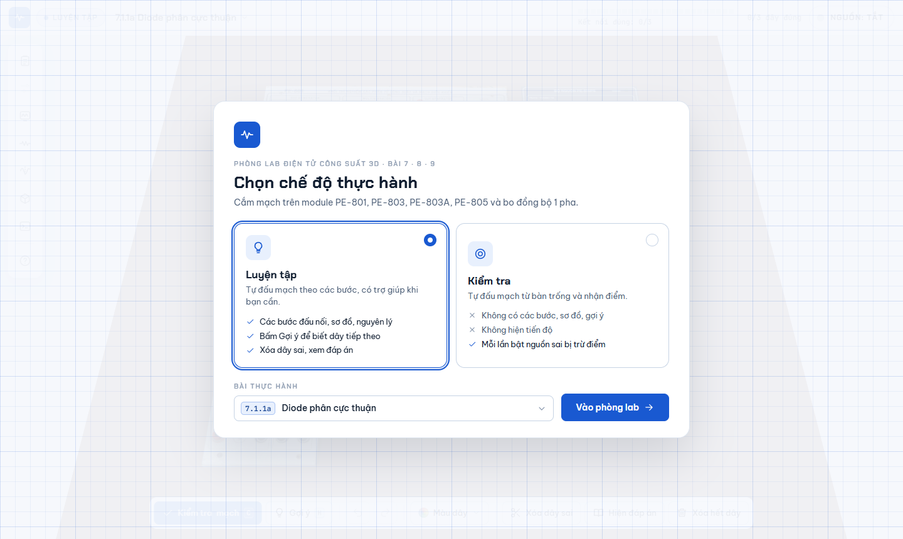
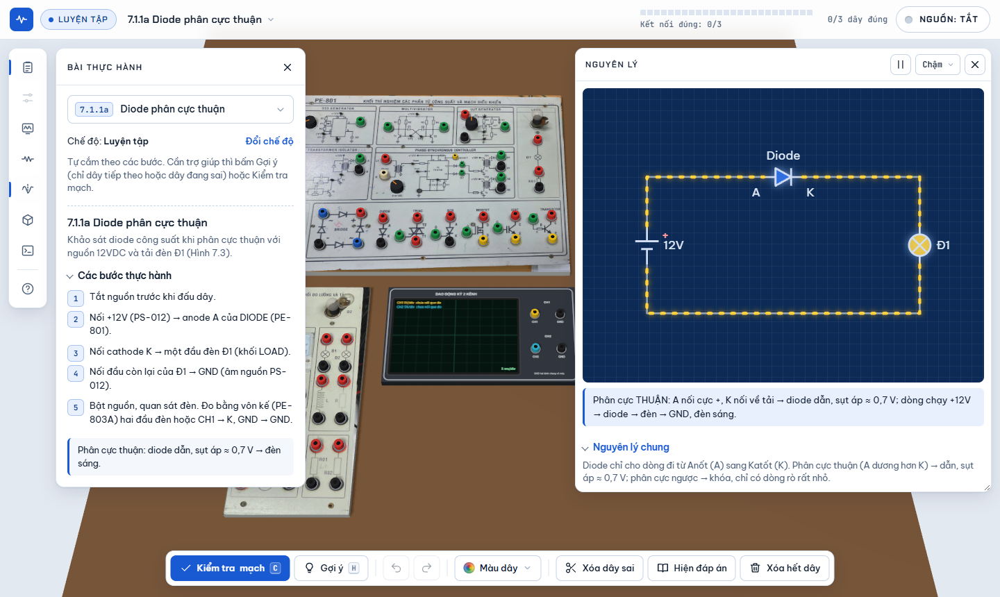
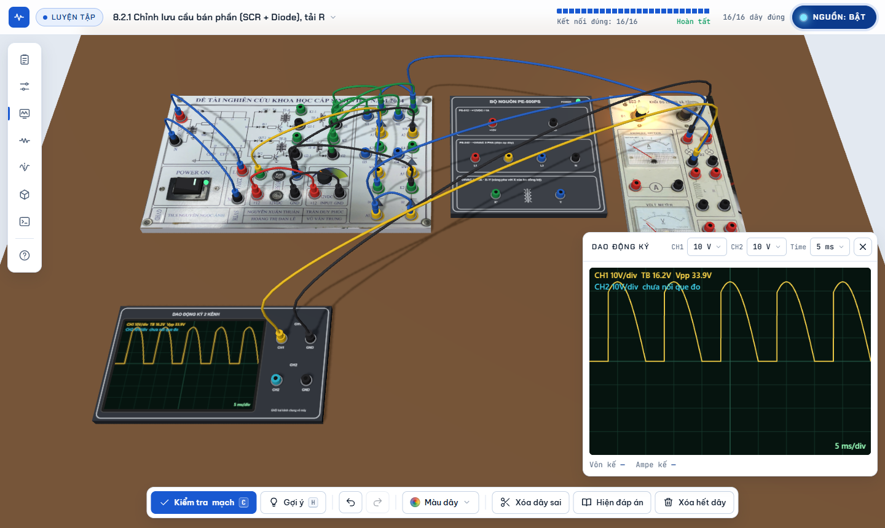

# Phòng Lab Điện tử công suất 3D

Phòng thí nghiệm ảo trên trình duyệt để luyện đấu nối mạch **Điện tử công suất (Bài 7 · 8 · 9)** trên mô hình 3D của các module PE-801, PE-802, PE-803, PE-803A, PE-805, bộ nguồn PE-500PS và bo điều khiển đồng bộ 1 pha. Người học cắm dây giữa các chốt, bật nguồn, quan sát đèn tải, vôn kế, ampe kế và dao động ký. Hệ thống tự chấm mạch đúng hay sai.



| Đang luyện tập: phiếu bài và bảng Nguyên lý | Mạch mẫu chạy: chỉnh lưu cầu bán phần, tải R |
|---|---|
|  |  |

## Mục lục

- [Tính năng](#tính-năng)
- [Danh sách bài thực hành](#danh-sách-bài-thực-hành)
- [Chạy thử](#chạy-thử)
- [Hướng dẫn sử dụng](#hướng-dẫn-sử-dụng)
- [Cấu trúc thư mục](#cấu-trúc-thư-mục)
- [Kiến trúc và mô hình mô phỏng](#kiến-trúc-và-mô-hình-mô-phỏng)
- [Thêm hoặc sửa một bài thực hành](#thêm-hoặc-sửa-một-bài-thực-hành)
- [Giới hạn của mô hình](#giới-hạn-của-mô-hình)
- [Triển khai](#triển-khai)
- [Công nghệ và trình duyệt hỗ trợ](#công-nghệ-và-trình-duyệt-hỗ-trợ)
- [Nguồn tư liệu](#nguồn-tư-liệu)

## Tính năng

- **26 bài thực hành** bám theo giáo trình Bài 7, 8, 9, cùng một chế độ thực hành tự do với tất cả module.
- **Hai chế độ**, chọn trước khi vào phòng lab:
  - **Luyện tập**: có các bước đấu nối, sơ đồ giáo trình và bảng Nguyên lý. Gợi ý chỉ hiện khi người học bấm **Gợi ý**. Có thêm Kiểm tra mạch, Xóa dây sai và Hiện đáp án.
  - **Kiểm tra**: bắt đầu từ bàn trống; không có các bước, sơ đồ, nguyên lý hay gợi ý; không hiện tiến độ; chấm điểm theo số lần sai.
- **Thiết bị đo ảo**: dao động ký 2 kênh (chỉnh V/div, Time/div), vôn kế, ampe kế, đèn tải sáng theo điện áp.
- **Núm điều chỉnh** theo bài: góc điều khiển α, tần số máy phát 555, độ rộng xung D, tần số nghịch lưu, công tắc chọn nhánh bộ 4 khóa.
- **Bảng Nguyên lý**: mạch tối giản kiểu bản vẽ, dòng điện chạy theo góc pha ωt, dạng sóng đồng bộ và giải thích từng khoảng dẫn.
- **An toàn điện**: phát hiện ngắn mạch nguồn, tính lỗi khi cắm hoặc rút dây lúc đang có điện.
- **Chạy được trên máy tính và điện thoại**: trên điện thoại, thanh công cụ chuyển xuống đáy và các bảng mở dạng ngăn kéo; điều khiển được bằng bàn phím.

## Danh sách bài thực hành

| Mã | Bài | Module chính |
|---|---|---|
| 7.1.1a / 7.1.1b | Diode phân cực thuận / ngược | PE-801 |
| 7.1.2 | Điều khiển Transistor, MOSFET, IGBT bằng xung | PE-801 |
| 7.2.1 | Chỉnh lưu 1 pha nửa chu kỳ | PE-801 |
| 7.2.2 | Chỉnh lưu cầu 1 pha không điều khiển | PE-801 |
| 7.3.1 | Chỉnh lưu 3 pha hình tia (diode) | PE-803 |
| 7.3.2 | Chỉnh lưu cầu 3 pha (diode) | PE-803 |
| 8.1.1 / 8.1.2 | Điều khiển không đồng bộ SCR / Triac (nguồn DC) | PE-801 |
| 8.1.3 | Điều khiển đồng bộ SCR, Triac, tải trở | Bo đồng bộ 1 pha, PE-801 |
| 8.2.1 – 8.2.2 | Chỉnh lưu cầu bán phần (SCR + Diode), tải R / RL | Bo đồng bộ 1 pha |
| 8.2.3 – 8.2.4 | Chỉnh lưu cầu toàn phần (4 SCR), tải R / RL | Bo đồng bộ 1 pha |
| 8.3 | Chỉnh lưu cầu 3 pha có điều khiển (6 SCR) | PE-803 |
| 9.3.1a – d | Bộ biến đổi DC-DC: Buck, Boost, Buck-Boost, bộ 4 khóa | PE-802 |
| 9.3.2 | Biến đổi điện áp AC 1 pha dùng Triac, tải R / RL | PE-801, PE-803A |
| 9.3.3 | Nghịch lưu ngõ ra sóng vuông / sóng sin | PE-805 |

Xem nhanh một mạch mẫu đã đấu sẵn và đang chạy: thêm `#demo=<mã bài>` vào cuối địa chỉ, ví dụ `index.html#demo=8.2.1`. Mã bài nằm ở trường `id` trong mã nguồn (xem [bên dưới](#thêm-hoặc-sửa-một-bài-thực-hành)).

## Chạy thử

Dự án là trang web tĩnh, **không cần cài đặt hay build**.

- **Cách nhanh nhất**: mở trực tiếp `index.html` bằng Chrome, Edge hoặc Firefox. Ảnh mặt module được nhúng sẵn trong `assets/textures.js` nên chạy được cả khi mở bằng `file://`.
- **Qua máy chủ cục bộ** (giống môi trường thật hơn):

  ```bash
  npx serve .
  # hoặc
  python -m http.server 8000
  ```

Cần kết nối mạng để tải thư viện three.js và phông chữ từ CDN.

## Hướng dẫn sử dụng

1. Chọn **chế độ** (Luyện tập hoặc Kiểm tra) và **bài thực hành**, rồi bấm **Vào phòng lab**.
2. Cắm dây: kéo từ chốt này thả vào chốt kia, hoặc bấm lần lượt hai chốt. Trên điện thoại thì chạm lần lượt hai chốt.
3. Rút dây: chuột phải vào dây, hoặc chọn dây rồi bấm **Rút dây** (hoặc phím `Del`).
4. Bật **Nguồn** khi đã đấu xong. Mạch đúng thì đèn sáng và dao động ký hiện dạng sóng.
5. Các bảng (Bài học, Núm chỉnh, Dao động ký, Sơ đồ, Nguyên lý, Góc nhìn, Nhật ký, Cách dùng) đều ẩn sẵn và chỉ mở khi bấm vào thanh công cụ.

**Phím tắt**

| Phím | Tác dụng | Phím | Tác dụng |
|---|---|---|---|
| `Space` | Bật / tắt nguồn | `C` | Kiểm tra mạch |
| `H` | Gợi ý (chế độ Luyện tập) | `S` | Sơ đồ mạch |
| `N` | Nguyên lý | `P` | Chạy / dừng Nguyên lý |
| `T` | Nhìn từ trên | `R` | Toàn cảnh |
| `0` – `6` | Chọn màu dây (`0` = tự động) | `Del` | Rút dây đang chọn |
| `Ctrl+Z` / `Ctrl+Y` | Hoàn tác / làm lại | `Esc` | Huỷ thao tác, đóng bảng |

**Điểm** khi mạch hoạt động: `100 − 10 × lần bật nguồn sai − 15 × lỗi an toàn − 3 × lượt gợi ý`. Nếu dùng **Hiện đáp án**, bài bị tính thêm 5 lượt gợi ý. Dây không được lưu lại: mỗi lần vào bài là một lượt mới với bàn trống.

## Cấu trúc thư mục

```text
.
├── index.html              # Khung trang + mã chính (module ES): module, bài thực hành, cảnh 3D, mô phỏng
├── css/
│   └── style.css           # Toàn bộ giao diện: bảng màu, kiểu chữ, bố cục máy tính / điện thoại
├── js/
│   ├── nguyen-ly.js        # Bảng Nguyên lý: mạch tối giản SVG, dòng điện chạy, dạng sóng theo ωt
│   └── dropdown.js         # Ô chọn tự vẽ (tìm kiếm không dấu, nhóm theo Bài, điều khiển bàn phím)
├── assets/
│   ├── textures.js         # Ảnh mặt các module (base64) dùng làm texture WebGL
│   └── schematics/         # Sơ đồ mạch trích từ giáo trình, đặt tên theo mã bài (vd. 8.2.1.png)
├── docs/
│   ├── DEPLOY.md           # Hướng dẫn triển khai lên Vercel
│   └── images/             # Ảnh chụp màn hình dùng trong README
├── vercel.json             # Cấu hình header và bộ nhớ đệm khi triển khai
├── .vercelignore
├── .editorconfig
├── .gitattributes
└── .gitignore
```

Mã chính được giữ **ngay trong `index.html`** (module ES nội tuyến) thay vì tách thành file `.js` riêng. Lý do: trình duyệt chặn nạp module ES từ file ngoài khi trang mở bằng `file://`, và giữ nội tuyến thì vẫn mở trực tiếp được bằng cách nhấp đúp.

## Kiến trúc và mô hình mô phỏng

Mã trong `index.html` chia thành 10 phần, mỗi phần có tiêu đề dạng `/* ==== N. TÊN ==== */`:

| # | Phần | Nội dung |
|---|---|---|
| 1 | Hằng số & mô hình tín hiệu | Lưới 50 Hz, nguồn ~24 VAC (X–Y), nguồn 3 pha 24 VAC, tham số núm (`ST`) |
| 2 | Định nghĩa module | Toạ độ (cm) các chốt trên mặt module, nối trong (`INTERNAL`), nhóm cực nguồn (`SOURCES`) |
| 3 | Bài thực hành | Mảng `EX`: mục tiêu, các bước, đáp án nối dây, thế điểm, cấu hình dao động ký |
| 4 | Cảnh three.js | Bàn, module, ánh sáng, camera, góc nhìn |
| 5 | Dây nối | Dựng dây 3D, hoàn tác / làm lại |
| 6 | Phân tích mạch | Gom nút mạng, chấm đúng/sai, phát hiện ngắn mạch |
| 7 | Giao diện | Phiếu bài, chế độ, tiến độ, kết quả, sơ đồ |
| 8 | Tương tác chuột | Bắt chốt và dây, kéo thả, cảm ứng, phím tắt |
| 9 | Mô phỏng | Đèn, đồng hồ đo, dao động ký |
| 10 | Vòng lặp | Vẽ khung hình |

**Phân tích mạch (phần 6).**

1. **Nút mạng.** Các chốt được nối bởi dây của người học và bởi đường nối trong module được gộp thành nút bằng cấu trúc *union-find* (`userUF`).
2. **Chấm bài.** Đáp án của một bài (`conns`) được dựng thành tập nút mạng chuẩn. Sau đó so với mạch của người học theo ba tiêu chí: thiếu kết nối (`missing`), dây nối hai nút không được phép nối (`wrongWires`), và các nút chuẩn bị gộp chung sai (`merges`).
3. **Cách nối tương đương.** Nhiều mạch có các cách nối đúng như nhau, ví dụ hoán đổi hai đầu đèn hay chọn cặp xung G1/K1 hoặc G1-1/K1-1. Chúng được khai báo trong `sym` và `alt`. Bộ chấm thử các tổ hợp để tìm cách ánh xạ có điểm phạt nhỏ nhất, với điểm phạt = `missing + 2·wrong + 2·merges`: duyệt hết nếu không quá 4096 tổ hợp, ngược lại dò cục bộ (đổi 1 hoặc 2 nhóm mỗi bước).
4. **Ngắn mạch.** Hai cực của cùng một nguồn rơi vào cùng một nút thì bị coi là ngắn mạch, và nguồn không bật được.

**Tín hiệu (phần 1 và 9).** Điện áp tại mỗi nút là một hàm giải tích theo thời gian `V(nút, t)`, chỉ được gán khi mạch đã đúng. Ví dụ với chỉnh lưu có điều khiển: `u_d(t)` là đoạn sin bắt đầu dẫn tại góc α, và trị trung bình khớp công thức giáo trình (cầu bán phần: `U_d = 0,45·U·(1 + cos α)`). Dao động ký lấy mẫu `V(t)` của hai kênh, đèn sáng theo trị hiệu dụng so với điện áp định mức của bài (`lampRated`).

**Bảng Nguyên lý (`js/nguyen-ly.js`).** Mỗi bài ánh xạ tới một mẫu mạch, gồm: các linh kiện, dây, và hàm `state(θ, α)` trả về linh kiện đang dẫn, đường dòng điện, xung kích và lời giải thích tại góc pha θ. Mẫu có sẵn gồm diode/khóa DC, mạch 1 linh kiện xoay chiều, cầu 1 pha, hình tia và cầu 3 pha, đẩy kéo, cầu H, Buck/Boost/Buck-Boost và bộ 4 khóa. Riêng dòng tải RL qua Triac được tính theo nghiệm `i(θ) = sin(θ − φ) − sin(α − φ)·e^{−(θ−α)/tan φ}`, với góc tắt β tìm bằng chia đôi.

## Thêm hoặc sửa một bài thực hành

1. **Bài và đáp án**: thêm một phần tử vào mảng `EX` (phần 3 trong `index.html`). Các trường chính:

   | Trường | Ý nghĩa |
   |---|---|
   | `id`, `grp`, `title` | Mã bài, nhóm (7, 8, 9; `0` = khác), tên hiển thị |
   | `mods` | Các module đặt trên bàn |
   | `goal`, `steps`, `note` | Mục tiêu, các bước, ghi chú (ẩn trong chế độ Kiểm tra) |
   | `conns` | Đáp án: danh sách cặp chốt `[a, b]` cần nối |
   | `sym`, `alt` | Các cách nối tương đương / phương án phụ được chấp nhận |
   | `pot` | Hàm điện áp gán cho các chốt khi mạch đúng |
   | `scope`, `trig`, `load`, `lampRated` | Thang đo dao động ký ban đầu, chu kỳ đồng bộ, hai đầu tải, điện áp định mức đèn |
   | `knobs` | Các núm hiện trong bảng Núm chỉnh (`alpha`, `f555`, `duty`, `q4`, `finv`) |

2. **Sơ đồ giáo trình**: đặt ảnh vào `assets/schematics/<tên>.png` rồi khai báo trong bảng `SCH` (phần 7) dạng `'<id>': [['<tên>', 'Hình x.y', 'Nguồn, trang n']]`.
3. **Nguyên lý**: thêm mã bài vào bảng `MAP` trong `js/nguyen-ly.js`, dùng lại một mẫu sẵn có hoặc viết mẫu mới.
4. Kiểm tra bằng `index.html#demo=<id>`: mạch phải tự cắm đủ dây, bật nguồn và chạy.

## Giới hạn của mô hình

Đây là công cụ luyện **đấu nối và đọc dạng sóng**, không phải trình giải mạch tổng quát kiểu SPICE.

- Dạng sóng được **định nghĩa sẵn theo từng bài** cho mạch đúng; mạch sai không chạy, chứ không mô phỏng hành vi sai.
- Linh kiện là **khóa lý tưởng**: bỏ qua sụt áp dẫn (trừ phần giải thích của diode), thời gian chuyển mạch và điện cảm nguồn. Tải RL dùng góc φ ≈ 45°; dòng tải cầu toàn phần RL coi như liên tục.
- Bộ DC-DC giả thiết dòng cuộn cảm liên tục, `U0` lấy theo công thức lý tưởng; Boost và Buck-Boost giới hạn D ≤ 85 %.
- Bảng Nguyên lý dùng đơn vị tương đối (biên độ chuẩn hoá), chỉ để minh hoạ hình dạng và khoảng dẫn.

## Triển khai

Trang tĩnh, triển khai được lên bất kỳ dịch vụ host tĩnh nào (Vercel, Netlify, GitHub Pages…). Hướng dẫn chi tiết cho Vercel: [docs/DEPLOY.md](docs/DEPLOY.md).

## Công nghệ và trình duyệt hỗ trợ

- [three.js](https://threejs.org/) r160 (nạp qua import map từ jsDelivr): dựng cảnh 3D, OrbitControls.
- JavaScript thuần (ES2022: module, top-level `await`, `?.`, `??`), không framework, không bước build.
- Phông chữ: Be Vietnam Pro, Chakra Petch, JetBrains Mono (Google Fonts).

Cần trình duyệt có **WebGL** và **import maps**: Chrome / Edge 89+, Firefox 108+, Safari 16.4+.

## Nguồn tư liệu

- Nội dung bài, các bước và sơ đồ trong `assets/schematics/` trích từ giáo trình và slide môn **Điện tử công suất** (Bài 7, Bài 8, Bài 9). Số hình và số trang được ghi kèm khi xem sơ đồ trong ứng dụng.
- Ảnh mặt module trong `assets/textures.js` chụp từ thiết bị thí nghiệm thật (PE-801, PE-803, PE-803A, PE-805, bo đồng bộ 1 pha). Mặt PE-802, bộ nguồn PE-500PS và dao động ký được vẽ bằng mã.
